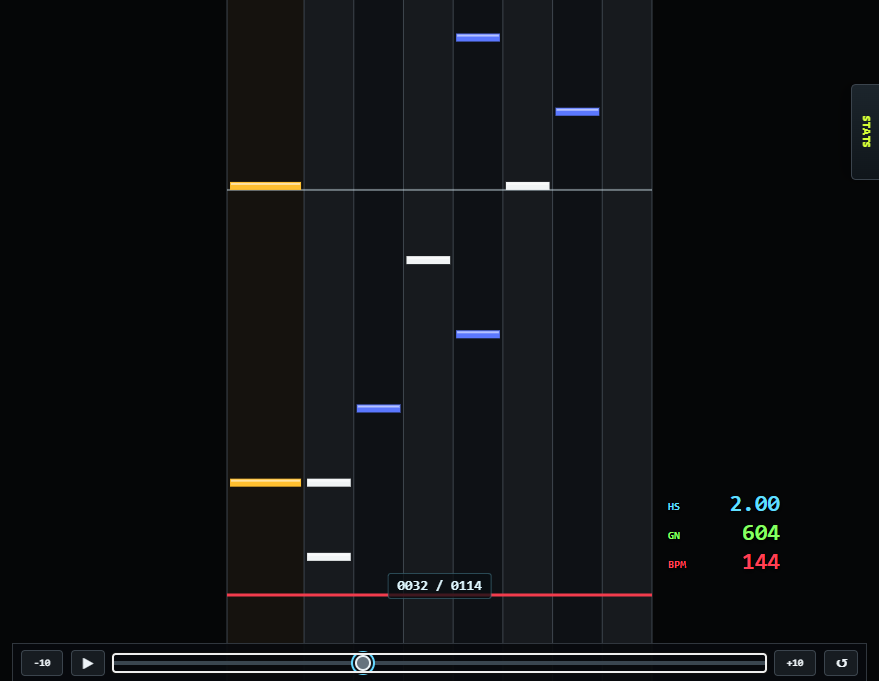
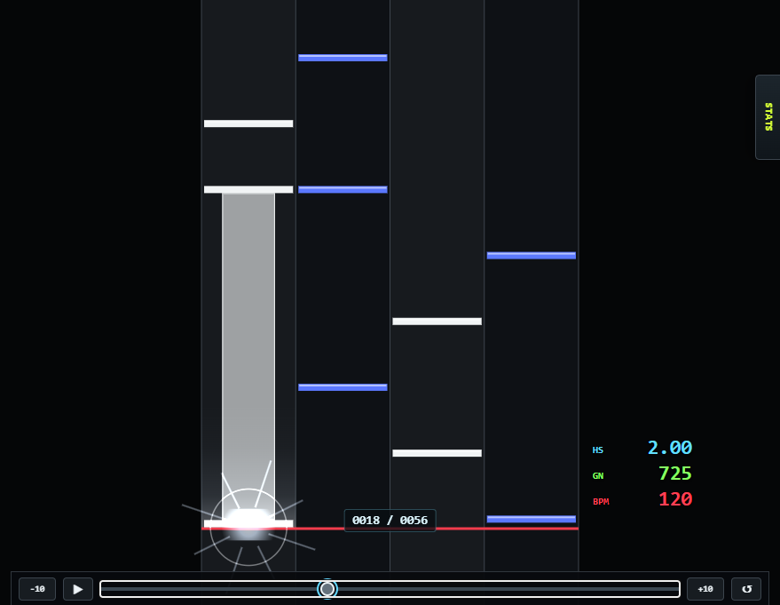
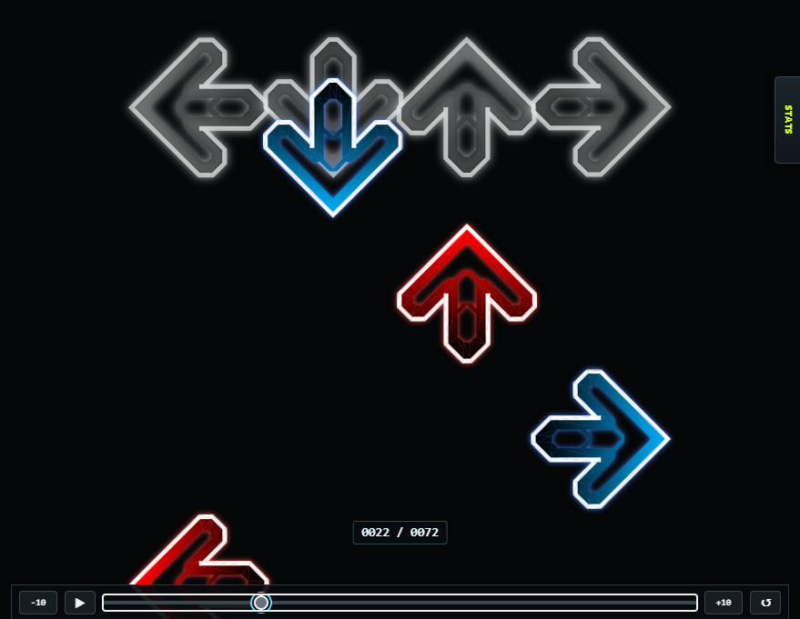
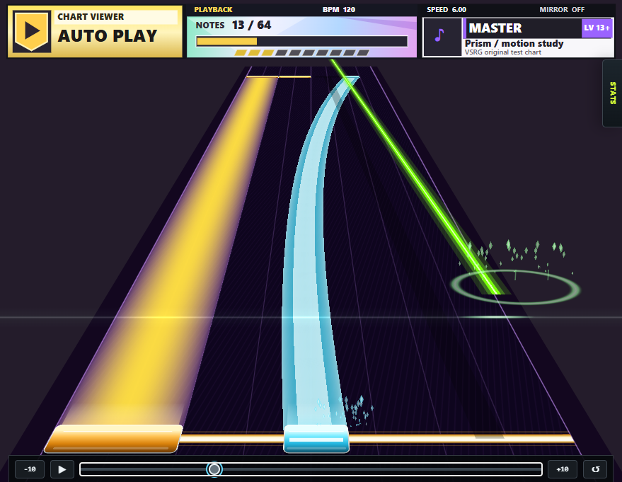

# VSRG Chart Viewer

Open a rhythm-game chart in your browser, watch it play with its audio, or inspect the notes one measure at a time. Chart files and media stay on your device.

**[Open the live viewer](https://shigexdw.github.io/VSRG-Chart-Viewer/)**

## Open a chart

1. On the start screen, choose **Open folder** to load a chart with its media, or **Open files** to select individual files or a ZIP or OSZ pack. When selecting files individually, include any audio and backgrounds you want to preview. Use **Open** in the header to load another chart later.
2. Pick a chart or difficulty from the list and press **Play**. Drag the timeline to revisit a passage, or change the song speed to study it more slowly.
3. Switch to **Chart Inspector** for the measure grid, note density, BPM changes, chords, and lane distribution.

To try a chart without any music files, download the [UGC demo chart](tests/fixtures/ugc-visual-showcase.ugc) and open it in the viewer. For local use, open `index.html` directly or serve the repository with a static web server.

## Playback modes

| BMS / BME / BMSON | osu!mania |
| --- | --- |
|  |  |
| Load `.bms` or `.bme` charts using base 36 or base 62, or BMSON 1.0 files. Preview keysounds, scratch notes, and image-sequence or video BGA. | Open a mania `.osu` file with its audio, or load the whole `.osz` or `.zip` beatmap pack and choose a difficulty. |

| StepMania / Etterna | UGC |
| --- | --- |
|  |  |
| Load `.sm` or `.ssc` stepcharts for dance-single or dance-double. Switch between upscroll and downscroll or adjust the spacing between columns. | Preview V4 and V8 `.ugc` charts on a 16-lane perspective field. Curved slides, AIR paths, and crush notes have dedicated artwork and hit effects. [UGC controls and known limits](docs/UGC.md) |

## Playback and inspection

- **Scroll speed and visibility.** BMS-style playback offers IIDX Hi-Speed with a green-number readout, fixed pixels per second, and SUDDEN+. UGC has its own note speed, field scale, divisions, and visual delay.
- **Lane patterns.** BMS-style charts support Normal, Mirror, Random, R-Random, and S-Random. Use the current and peak KPS readouts or the notes radar to compare difficult passages.
- **Measure inspection.** Jump to the current measure or let the inspector follow playback. On UGC charts, point to or tap a note to identify its type, direction, and occupied lanes. Overlapping judgments are listed together.

Audio and video playback depend on the codecs available in your browser. WMA, WMV, and ASF files in particular may require conversion.

## Licenses

The viewer code is released under the [MIT License](LICENSE). Bundled libraries and noteskin artwork have their own licenses and credits. [Third-party notices](THIRD_PARTY_NOTICES.md)
