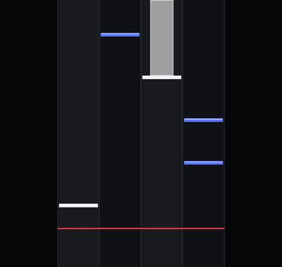
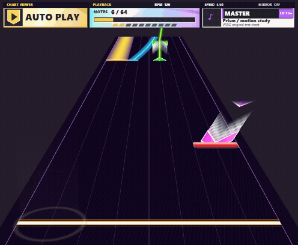
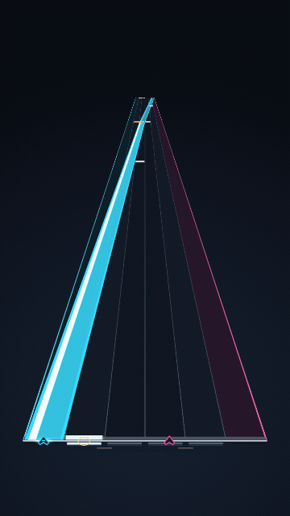

# VSRG Chart Viewer

Autoplay rhythm game charts in your browser with music, keysounds and background media. The **Chart Inspector** shows notes, timing changes and density measure by measure.

**[Open the live viewer](https://shigexdw.github.io/VSRG-Chart-Viewer/)** or open `index.html` locally. Choose **Open folder** for a song with its media or **Open files** for individual files and packs. Select a difficulty and press **Play**.

## Supported modes

| BMS / BME / BMSON | osu!mania | maimai / Simai / AstroDX |
| --- | --- | --- |
|  |  |  |
| Open `.bms`, `.bme`, `.bml` or BMSON 1.0 charts. BMS supports base 36 and 62, STOP timing, LNOBJ holds, RANDOM branches, keysounds and BGA. The player includes Hi-Speed, green number, fixed scrolling, lane mods and SUDDEN+. | Open a mania `.osu` file with its audio, or load an `.osz` or ZIP pack and choose a difficulty. Preview the chart’s key layout, chords and long notes. | Open `maidata.txt`, a Majdata song folder or an AstroDX `.adx` pack. Follow touch notes, holds and slide chains around the circular field. Import charts from Mai Notes, use the optional 3D Virtual Cabinet mode, or export portrait/landscape 1080p60 MP4s with audio. [Guide](docs/MAIMAI.md) |

| StepMania / Etterna | UGC / SUS | SOUND VOLTEX / K-Shoot MANIA |
| --- | --- | --- |
|  |  |  |
| Open dance-single or dance-double `.sm` and `.ssc` charts. XMod follows BPM changes, stops and scroll reversals. Switch between upscroll and downscroll, or use fixed-speed scrolling to read a dense passage. [Modchart guide](docs/STEPMANIA.md) | Open V4/V8 `.ugc` charts or Ched-style `.sus` charts. The 16-lane field shows curved slides, raised AIR paths and a judge line that follows their height. Select a note in the inspector to see its type, direction and lanes. [Format guide](docs/UGC.md) | Open a USC or K-Shoot MANIA song folder or ZIP with its `.ksh` difficulties and audio. Follow BT notes, FX holds and laser slams on a tilting highway with an optional local USC skin, or inspect individual measures. [Format guide](docs/SOUND-VOLTEX.md) |

Try these demos with **Open files**. [Simai · Orbit Study](tests/fixtures/maimai/maidata.txt), [UGC · Prism](tests/fixtures/ugc-visual-showcase.ugc) or [KSH · Relay Circuit](tests/fixtures/relay-circuit.ksh).

## Virtual Cabinet mode

Load a maimai chart, then enable **Virtual Cabinet mode** in its settings. Browse difficulties and adjust options using the cabinet buttons or keyboard, with animated menus, illuminated buttons and live upper displays. Drag to rotate, right-drag or Shift-drag to pan, and scroll to zoom.

Export a single station in portrait or both stations in landscape at **1080p60 with audio**, using five fixed camera presets. [Cabinet and export guide](docs/MAIMAI.md)

## Roadmap

✅ Supported | 🟨 WIP | ❌ Not implemented yet | ⬜ In preparation

- ✅ Majdata / Simai / AstroDX (maimai)
- 🟨 BMS / BME / BMSON (base 36 and 62, IIDX)
- ✅ UGC / SUS (CHUNITHM)
- 🟨 StepMania / Etterna
- ⬜ SaGEKI / OGKR (ONGEKI)
- 🟨 Unnamed SDVX Clone / K-Shoot MANIA (SOUND VOLTEX): KSH supported, KSON planned
- ❌ osu!standard + Catch!
- ❌ Taiko
- ⬜ Project DIVA
- ❌ Spin Rhythm XD
- ❌ Quaver
- ❌ Phira (Phigros)
- ❌ PJSK (Project Sekai)
- ❌ ArcCreate (Arcaea)
- ❌ DTXMania

## Development and licenses

Viewer code is [MIT licensed](LICENSE). Bundled libraries, noteskins and the CC BY-NC-SA 4.0 cabinet model have [separate licenses and credits](THIRD_PARTY_NOTICES.md).
