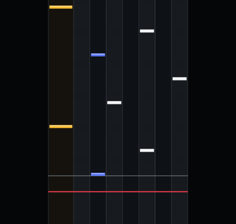
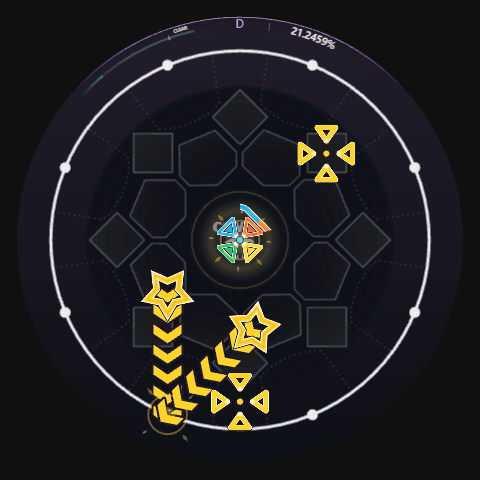
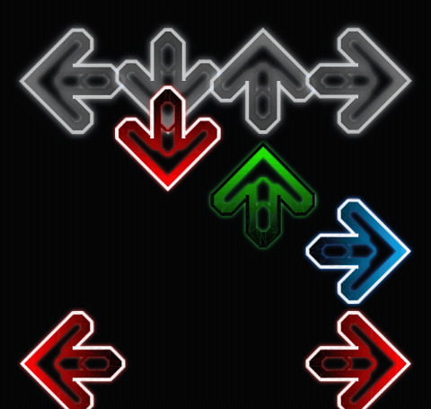
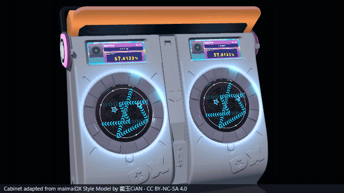

# VSRG Chart Viewer

Autoplay rhythm game charts in your browser with music, keysounds and background media. The **Chart Inspector** shows notes, timing changes and density measure by measure.

**[Open the live viewer](https://shigexdw.github.io/VSRG-Chart-Viewer/)** or open `index.html` locally. Choose **Open folder** for a song with its media or **Open files** for individual files and packs. Select a difficulty and press **Play**.

## Supported modes

| BMS / BME / BMSON | osu!mania | maimai / Simai / AstroDX |
| --- | --- | --- |
|  |  |  |
| Open `.bms`, `.bme`, `.bml`, or `.bmson` charts with keysounds and background animations. Adjust Hi-Speed, lane mods, and SUDDEN+ in the player. | Open a mania `.osu` chart with its audio, or load an `.osz` or ZIP pack. Preview key layouts, chords, and long notes. | Open `maidata.txt`, a Majdata song folder, or an AstroDX `.adx` pack. Follow taps, touch notes, holds, and slide chains around the circular field. You can also import from Mai Notes. [Guide](docs/MAIMAI.md) |

| StepMania / Etterna | Umiguri / SUS | SOUND VOLTEX / K-Shoot MANIA |
| --- | --- | --- |
|  |  |  |
| Open dance-single or dance-double `.sm` and `.ssc` charts. Follow the chart’s BPM changes, stops, and scroll reversals, or choose fixed-speed scrolling. [Modchart guide](docs/STEPMANIA.md) | Open `.ugc` or `.sus` charts to follow slides and AIR notes on the 16-lane field. Point to a note in the inspector to see its type, direction, and lanes. [Format guide](docs/UGC.md) | Open a USC or K-Shoot MANIA song folder or ZIP with its `.ksh` charts and audio. Follow BT notes, FX holds, and laser slams with the built-in view or a local USC skin. [Format guide](docs/SOUND-VOLTEX.md) |

## Playback and inspection

Use **Song speed** to slow down a passage or the format’s note-speed control to change how far ahead notes appear. In **Chart Inspector**, check the lane distribution, largest chord, and peak note density. Click the density graph to jump to a passage, or enable **Auto-follow** to keep the current measure in view.

## Virtual Cabinet mode

Load a maimai chart, then enable **Virtual Cabinet mode** in the maimai settings. Use the illuminated cabinet buttons or keyboard to choose a difficulty and start playback. Drag to rotate, right-drag or Shift-drag to pan, and scroll to zoom. The upper display shows achievement during play and a judgment breakdown at the end.

Use **Export MP4** to save the circular playfield, one cabinet station in portrait, or both stations in landscape at **1080p60 with audio**. The cabinet presets open a viewfinder so you can adjust the framing before rendering. [Cabinet and export guide](docs/MAIMAI.md#export-video)

## Roadmap

✅ Supported | 🟨 WIP | ❌ Not implemented yet | ⬜ In preparation

- ✅ Majdata / Simai / AstroDX (maimai)
- 🟨 BMS / BME / BMSON (base 36 and 62, IIDX)
- ✅ UGC / SUS (CHUNITHM)
- 🟨 StepMania / Etterna
- ⬜ SaGEKI / OGKR (ONGEKI)
- 🟨 Unnamed SDVX Clone / K-Shoot MANIA (SOUND VOLTEX): KSH supported, KSON planned
- ❌ osu!standard + Catch!
- ❌ Taiko
- ⬜ Project DIVA
- ❌ Spin Rhythm XD
- ❌ Quaver
- ❌ Phira (Phigros)
- ❌ PJSK (Project Sekai)
- ❌ ArcCreate (Arcaea)
- ❌ DTXMania

## Development and licenses

Viewer code is [MIT licensed](LICENSE). Bundled libraries, noteskins and the CC BY-NC-SA 4.0 cabinet model have [separate licenses and credits](THIRD_PARTY_NOTICES.md).
