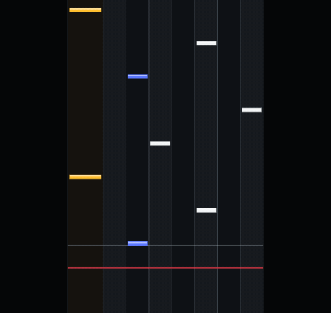
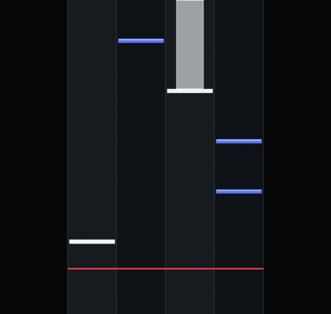
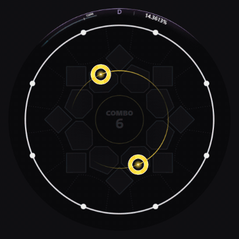
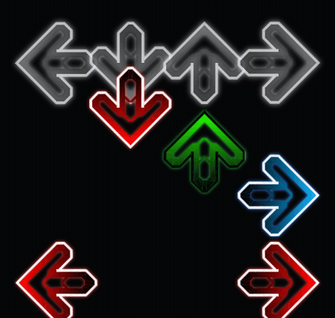
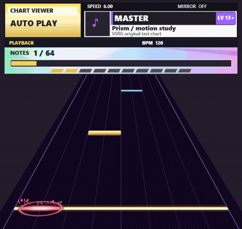

# VSRG Chart Viewer

Autoplay rhythm game charts in your browser with music, keysounds and background media. The **Chart Inspector** shows notes, timing changes and density measure by measure.

**[Open the live viewer](https://shigexdw.github.io/VSRG-Chart-Viewer/)** or open `index.html` locally. Choose **Open folder** for a song with its media or **Open files** for individual files and packs. Select a difficulty and press **Play**.

## Supported modes

| BMS / BME / BMSON | osu!mania | maimai / Simai / AstroDX |
| --- | --- | --- |
|  |  |  |
| Open `.bms`, `.bme` or BMSON 1.0 charts. BMS supports base 36 and 62, keysounds and image-sequence or video BGA. The player includes Hi-Speed, green number, fixed scrolling, lane mods and SUDDEN+. | Open a mania `.osu` file with its audio, or load an `.osz` or ZIP pack and choose a difficulty. Preview the chart’s key layout, chords and long notes. | Open `maidata.txt`, a Majdata song folder or an AstroDX `.adx` pack. Follow touch notes, holds and slide chains around the circular field. Import charts from Mai Notes or export playback as a 1080p60 MP4 with audio. [Guide](docs/MAIMAI.md) |

| StepMania / Etterna | UGC / SUS |
| --- | --- |
|  |  |
| Open dance-single or dance-double `.sm` and `.ssc` charts. XMod follows BPM changes, stops and scroll reversals. Switch between upscroll and downscroll, or use fixed-speed scrolling to read a dense passage. [Modchart guide](docs/STEPMANIA.md) | Open V4/V8 `.ugc` charts or Ched-style `.sus` charts. The 16-lane field shows curved slides, raised AIR paths and a judge line that follows their height. Select a note in the inspector to see its type, direction and lanes. [Format guide](docs/UGC.md) |

## Roadmap

- (OGKR)
- chart support for Unnamed SDVX Clone (USC) and K-Shoot MANIA (KSM)
- osu!standard + Catch!
- Taiko
- Project DIVA
- Spin Rhythm XD
- Quaver
- Phira (Phigros)
- PJSK
- ArcCreate (Arcaea)
- DTXMania

## Development and licenses

No build step is required. Run the tests with `node --test tests/*.test.cjs`. Viewer code is [MIT licensed](LICENSE). Bundled libraries and noteskins have [separate licenses and credits](THIRD_PARTY_NOTICES.md).
