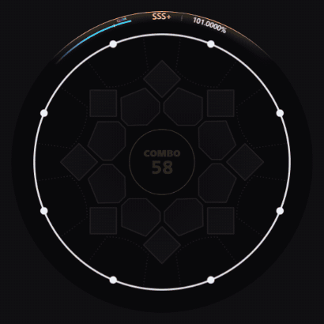

# maimai / Simai

Choose a song folder, a ZIP, or an individual `maidata.txt`. The chart selector lists each populated `&inote_N` with its difficulty and level. When selecting individual files, include the track and background files for media playback. A ZIP may contain several song folders with identically named tracks.

The loader looks beside each chart for `track.mp3`, `track.ogg`, or another supported audio format. It recognizes `bg.png`, `bg.jpg`, and browser-playable videos named `bg`, `pv`, or `mv`. Explicit track, cover, and video filenames take precedence when present. The circular field shows the song jacket or synchronized video. The BGA backdrop switch also fills the surrounding area. Difficulties in the same song share decoded audio and background resources.

## AstroDX levels

Use **Open files** for a single level or multi-song collection in an `.adx` or `.adx.zip` archive. **Open folder** also accepts an extracted `levels` directory. When a song includes both `maidata.txt` and the older `maidata_dx.txt`, both sets of difficulties are selectable. The latter carries the **legacy DX** label. The same Simai playback and notation limits apply. [AstroDX archive guide](https://wiki.astrodx.com/en/install/android)

## Reading the field

Button 1 is just right of twelve o’clock. Numbers increase clockwise. Taps move outward to the white judgment ring. A hold stays at the ring until its tail arrives. The sensor point appears first. The four touch petals fade in at their starting positions during the first fifth of the approach, then accelerate inward. A touch hold stays closed while its gauge fills. Gold marks simultaneous notes, orange marks BREAK, and an additional bright outline marks EX. A moving star consumes slide chevrons along the authored path. The center combo counts taps on contact and holds, touch holds and slides on completion. The upper arc shows the autoplay achievement and rank. The frame blends between rank colors over the song: violet at D, blue at B, green at A, silver at S and gold at SSS. The rank badge animates on promotion, and the cyan achievement gauge marks CLEAR at 80%. Achievement weights each judgment by note type and includes a bonus of up to one percentage point for BREAKs. The viewer autoplays every judgment.

**Extra info** shows the FiNALE and DELUXE achievement rates, judged and total notes by type, and the chart clock. BREAKs are counted separately. Touch holds count as holds. The setting starts off and is remembered in this browser.

The Playfield settings adjust blur and darkness behind the notes, the visibility of the sensor pattern, and hit effects. The blur control is available for songs with a background image or video. These preferences are saved separately for maimai.

The maimai approach-speed control changes visibility and travel time. Song speed, pause, seek and audio use the common player. Seeking into a slide, a hold or a waiting star reconstructs its position from chart time. The inspector unfolds buttons 1–8 into columns and labels the touch sensors. Its slide lines show button endpoints and timing. The circular player shows the actual path.

## Autoplay feedback

The player synthesizes its own tap, EX, BREAK, touch, slide and firework sounds. A hold sounds at contact and release. A touch hold sustains until release. Seeking into one resumes its sustained sound. **Hitsounds** toggles these cues.

**Hit effects** toggles judgment flashes and button lights. Firework-marked notes always emit rainbow rays on judgment, including in MP4 exports. Seeking reconstructs both the animation and the combo from chart time.

## Notation

- Song title, artist, difficulty levels and designers, the first-beat offset, BPM changes, subdivisions, and comma rests.
- Numbered taps and compact chords, slash-separated simultaneous notes, and backtick-separated pseudo-EACH groups.
- Holds, BREAK and EX modifiers, forced stars, A/B/C/D/E touches, touch holds and firework effects.
- Straight, circular, V, zigzag, loop and fan slides using `-`, `<`, `>`, `^`, `v`, `V`, `s`, `z`, `p`, `q`, `pp`, `qq`, and `w`. A fan has three tracing stars. `*` shares a head between tracks. `?` and `!` omit the approaching star head.
- The viewer recognizes mine markers on notes and slide paths, trailing firework markers on touch holds, and negative subdivisions that place subsequent notes earlier in the song. Mines use a separate color and autoplay avoids their hit cues.
- Slide movement defaults to a one-beat wait. Brackets accept subdivision ratios, BPM overrides, seconds, and explicit wait/duration pairs such as `[0.25##1.5]`. Connected slides accept a duration per segment or one duration for the whole path. The latter is divided by path length.
- Positive `<HS*…>` approach multipliers, `&mv_wait`, and `&mv_seek`. Unsupported tokens produce line-numbered chart diagnostics in the player settings.

## Reference and validation

The browser parser, path geometry, and Canvas sprites are implemented in this repository. The viewer draws its own note artwork using the FiNALE skin as a visual reference for the open rings, five-point stars, hold caps, and colored touch petals. [FiNALE skin reference](https://github.com/TeamMajdata/MajdataPlay_Build/tree/e8c0cd301f52847e5d7436c0575984742c646933/Skins/FiNALE) MajdataPlay served as a behavior reference. Its Unity code, parser binary, sample songs and artwork are external to the viewer.

- MajSimai supplies song metadata, difficulty slots, timing points and note properties. MajdataPlay’s song storage and game manager supply folder conventions, chart offsets and video timing. [Song storage](https://github.com/TeamMajdata/MajdataPlay/blob/33250cf75ba2d3256d48583797b31b45fcf9e987/Assets/Scripts/Misc/Base/SongStorage.cs) · [Game manager](https://github.com/TeamMajdata/MajdataPlay/blob/33250cf75ba2d3256d48583797b31b45fcf9e987/Assets/Scripts/Scenes/Game/GamePlayManager.cs)
- The reference note loader schedules heads and traces separately. The slide translator and geometry describe button orientation, arcs, loops and connected tracks. [Note loader](https://github.com/TeamMajdata/MajdataPlay/blob/33250cf75ba2d3256d48583797b31b45fcf9e987/Assets/Scripts/Scenes/Game/NoteLoader.cs) · [Slide translator](https://github.com/TeamMajdata/MajdataPlay/blob/33250cf75ba2d3256d48583797b31b45fcf9e987/Assets/Scripts/Scenes/Game/Misc/Parsing/SimaiSlideTranslator.cs) · [Simai notation](https://w.atwiki.jp/simai/pages/1003.html)
- An external comparison ran MajSimai 3.0.1 from that revision against all 14 included original-song charts. Across 41 difficulties, all 22,158 objects matched on type, button or center sensor, and onset within 0.1 ms, and on hold duration, slide start and slide duration within 1 ms. This comparison covers parsing and timing. The viewer generates its own artwork and samples slide paths by distance. Unity frame-for-frame appearance and proprietary extensions such as extended slide code and scripted scenes are outside this validation.
- Six slide centerlines were checked against the ordered marker positions in the reference prefabs. At equal fractions of path length, the largest observed distance ranged from less than 0.1% of the judgment radius for the straight line and outer arc to about 3.7% for the zigzag. The viewer uses analytical turns and distance sampling rather than importing those prefab coordinates.
- Run `node --test tests/*.test.cjs` for the mechanics tests. The optional Chromium test in `tests/browser-smoke.cjs` also covers ZIP import, selecting difficulties, deterministic redraw after seeking, the inspector, and switching to other formats. The [original demo chart](../tests/fixtures/maimai/maidata.txt) can be used without media.

## Song intro

Play opens a pastel song card with the selected difficulty, level, jacket and chart credits. The complete card stays on screen for three seconds at every song speed. A circular wipe reveals the field before the song clock reaches zero. Pause or scrub anywhere in the intro, or seek to zero to go straight to the chart. Replay includes the intro.

## Autoplay clear

After the track and final note effect finish, the circular field shows CLEAR. A diagonal shutter closes, holds for one chart second, and opens onto the result. The song panel uses the loaded jacket when available. The rows show the chart’s TAP, HOLD, SLIDE, TOUCH and BREAK totals and shares; the bottom strip shows the final autoplay DELUXE rate. Seeking back restores the playfield, and Replay starts the chart again.

## Export video

In the maimai settings, choose **Export MP4 · 1080p60**. Drag the progress bar by its header to move it. Choose **Save MP4** when the render finishes, or **Cancel** to discard a running export.

The export renders the selected difficulty from the intro through the final result at 1920 × 1080 and 60 frames per second. The video encoder targets 32 Mbps (about 240 MB per minute of video at that rate). Actual size depends on the encoder and scene. It uses the playback speed, pitch setting, volume, hitsound switch and maimai playfield settings selected at the start. Extra info appears when enabled. The area outside the circular stage is black. Include the song's audio, image and video files when opening a local chart. Mai Notes imports can use the viewer's hitsounds.

Rendering takes place locally. For 1080p60 video the exporter first requests hardware encoding for H.264, VP9 and AV1, in that order. If the browser reports no matching configuration, it tries the browser defaults. The progress bar shows the selected codec and preference. The browser controls which encoder fulfills the request. Audio is mixed separately and stored as AAC, Opus or PCM.

The optional `node tests/maimai-export.cjs` check creates a short chart and media locally, downloads the export, and verifies its frame count, dimensions, audio and black border. It uses the same Playwright configuration as the browser smoke test and requires FFmpeg and ffprobe on PATH.
